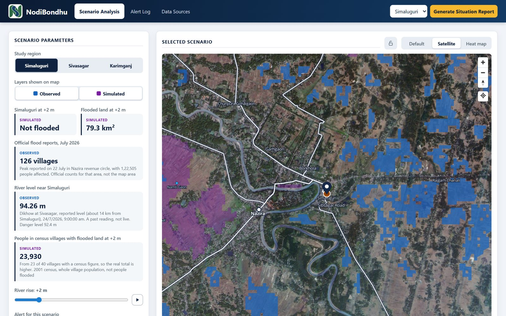
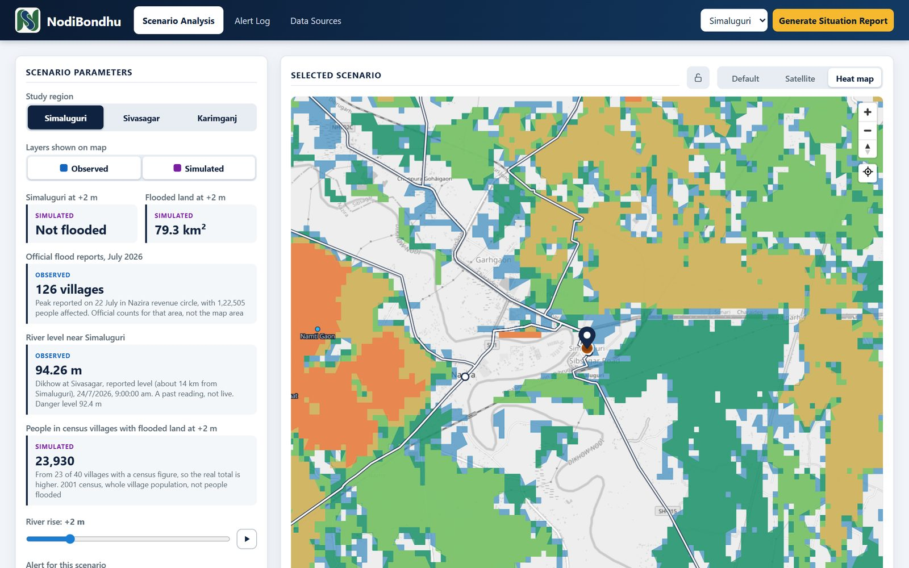
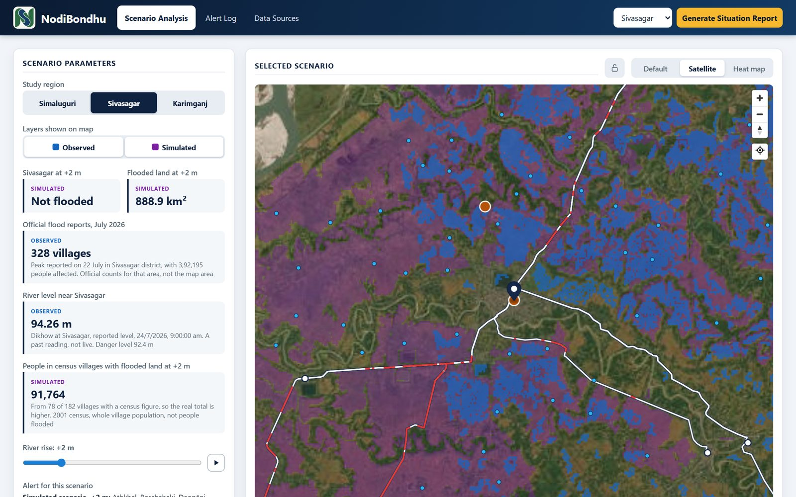
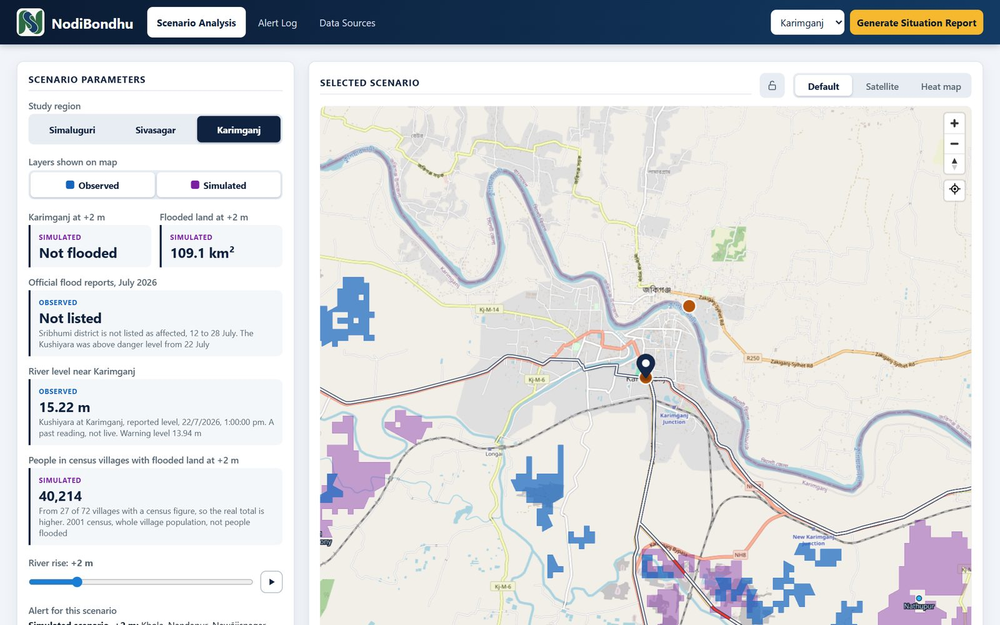
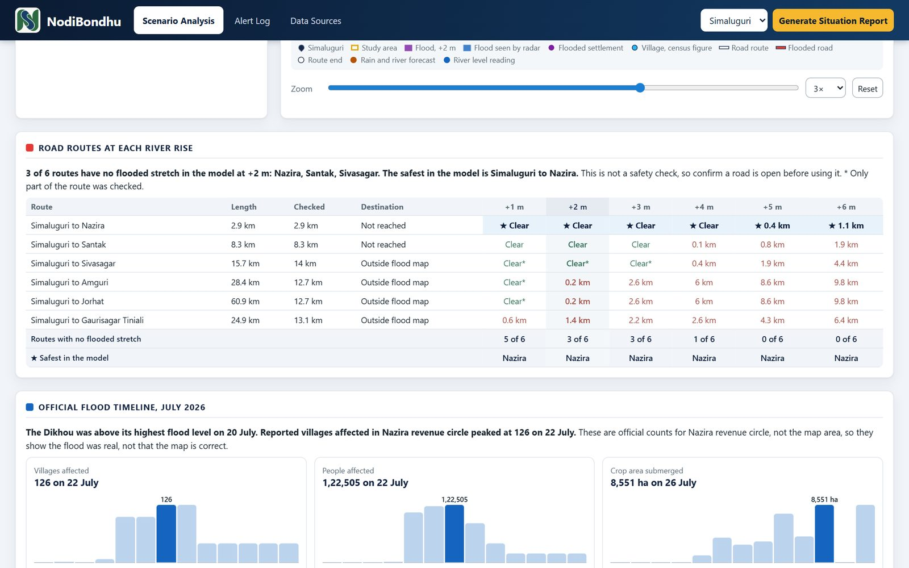
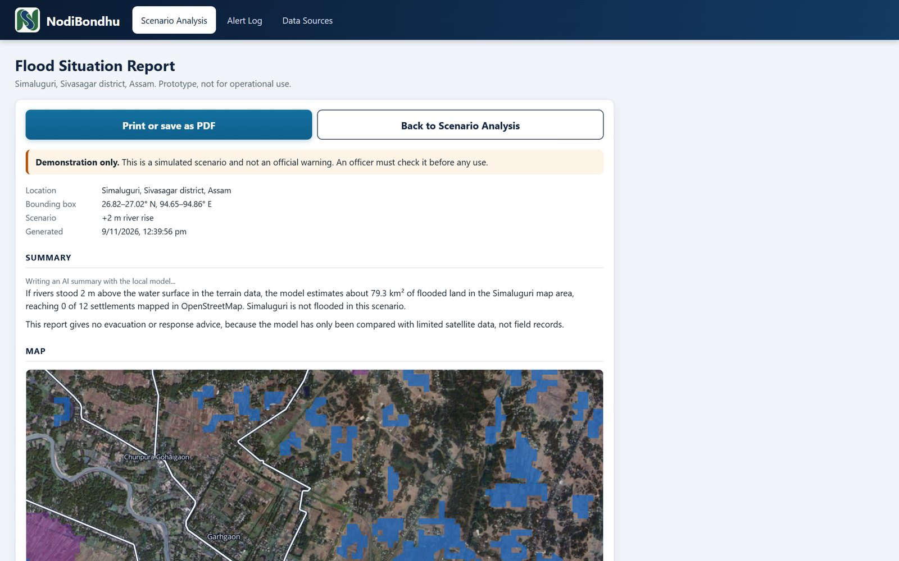
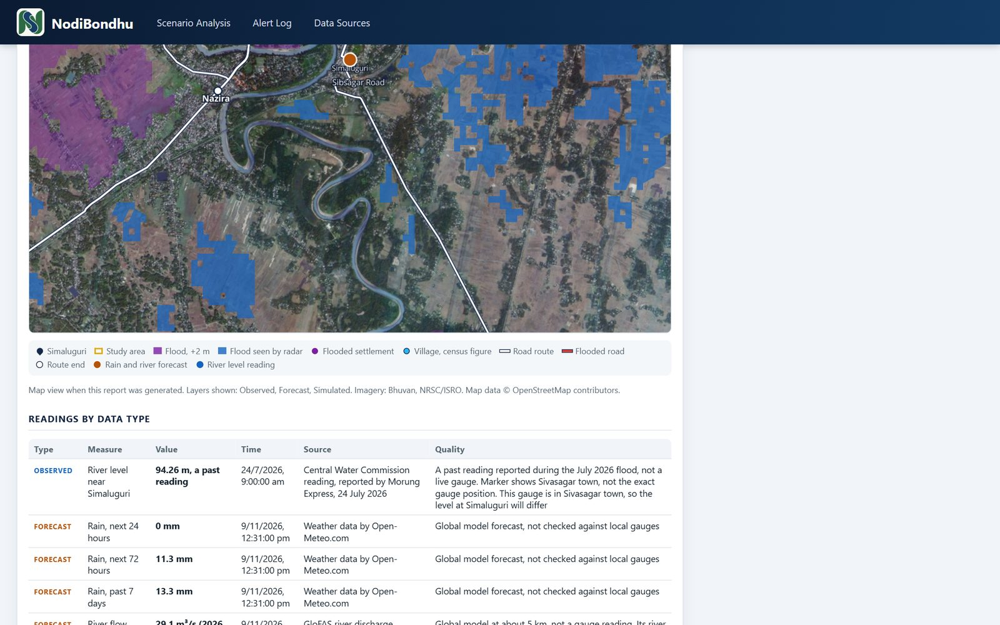
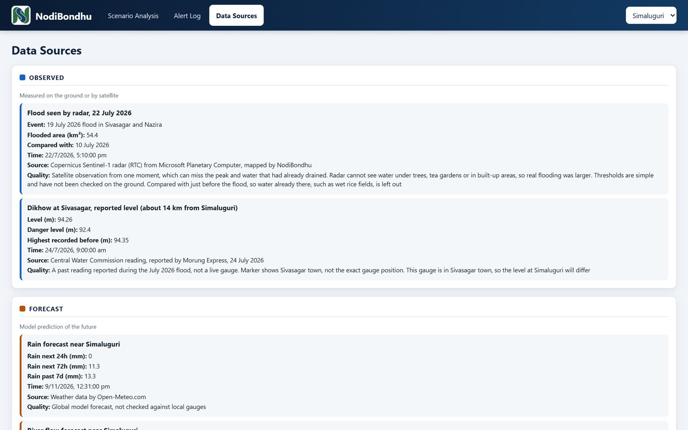
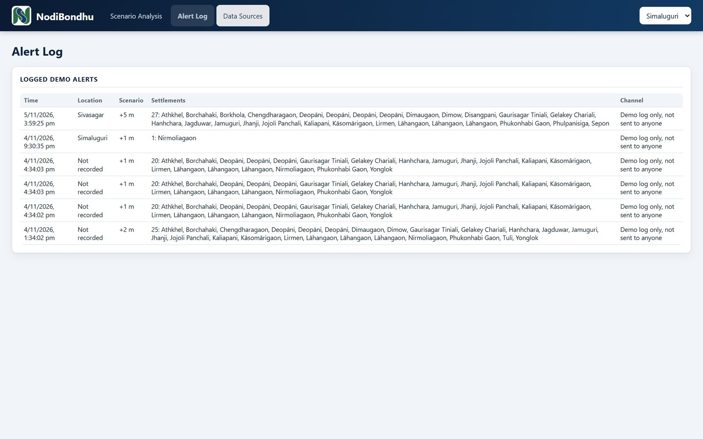
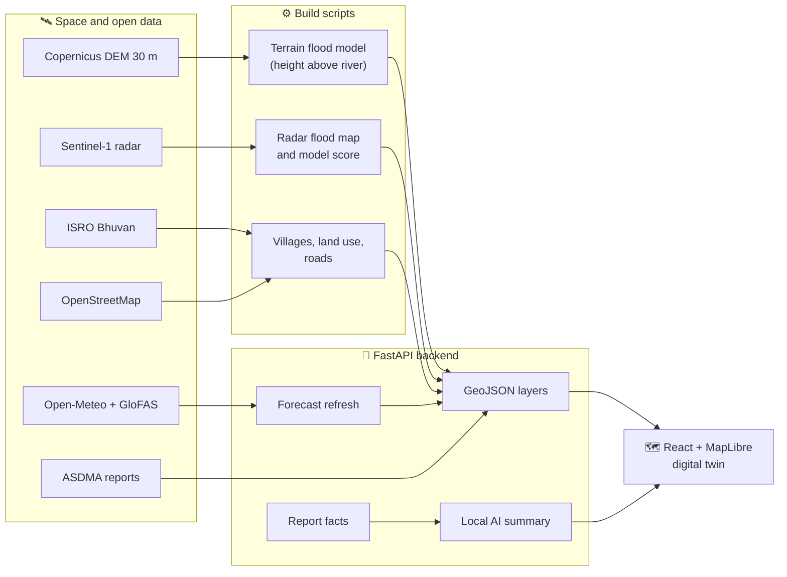

<div align="center">


# NodiBondhu

**A flood digital twin for Assam, built on space data.**

*Nodi Bondhu (নদী বন্ধু) means "friend of the river".*

See which land, villages and roads a river rise would flood, check it against satellite radar, and turn it into a report an officer can act on.


Built by **Team PIXELS** for **NESFIC-D-18: Digital Twin for Flood Management, Simulation and Early Warning Using Space Technology**.

</div>



---

## Contents

- [Why NodiBondhu](#why-nodibondhu)
- [What it does](#what-it-does)
- [Screenshots](#screenshots)
- [Study regions](#study-regions)
- [How it works](#how-it-works)
- [Data sources](#data-sources)
- [Tech stack](#tech-stack)
- [Run it locally](#run-it-locally)
- [Project structure](#project-structure)
- [API](#api)
- [Extending the twin](#extending-the-twin)

---

## Why NodiBondhu

Every monsoon, the Brahmaputra and Barak valleys flood. In July 2026, Assam's official reports counted more than **7 lakh people affected in a single day**, and about **4 lakh** in Sivasagar district alone.

Disaster officers need to know three things, fast:

| Question | How NodiBondhu answers it |
|---|---|
| **What would flood?** | What-if flood maps for river rises of +1 to +6 m, drawn on satellite imagery |
| **Who and what is in the way?** | Villages, census population, land use and main roads reached by each scenario |
| **How far can we trust it?** | Every figure is labelled **Observed**, **Forecast** or **Simulated**, with its source, and every scenario is scored against Sentinel-1 radar |

## What it does

| | Feature | Details |
|---|---|---|
| 🌊 | **Flood scenarios** | 18 flood maps (+1 to +6 m for three regions) from a terrain model built on the Copernicus 30 m elevation model. A slider and a play button let you watch the water rise |
| 🛰️ | **Radar check** | Flood extent seen by Sentinel-1 radar in July 2026, drawn on the map, with an overlap score for every scenario |
| 🗺️ | **Three map views** | Bhuvan satellite imagery, a clean street map, and a heat map that shows the rise at which each area first floods |
| 🏘️ | **People and places** | About 800 census villages, mapped settlements, estimated flooded land use, and 24 main road routes checked stretch by stretch |
| 📈 | **Live forecasts** | Rain for the next 24 and 72 hours, and GloFAS river flow for the next 7 days compared with the 2026 monsoon peak, kept up to date automatically |
| 📋 | **Official reports** | 17 days of ASDMA daily flood reports (12–28 July 2026), with charts of villages, people and crops affected, and river danger levels |
| 📄 | **Situation Report** | A one-page printable report with the map, key figures, a source table and an AI-written summary |
| 🤖 | **Local AI summary** | A small language model (Llama 3.2 3B through LM Studio or Ollama) turns the report's figures into plain sentences. It runs on the officer's own computer, and every number it writes is checked against the data |
| 🔔 | **Alert workflow** | An officer approves an alert for a scenario, and NodiBondhu logs which settlements it covers, ready to hand to an SMS or siren system |
| 🔎 | **Data Sources tab** | Every layer and reading with its source, time and quality note. Click anything on the map to jump to its record |

## Screenshots

<table>
  <tr>
    <td width="50%"><br /><b>Heat map</b>: the river rise at which each area first floods</td>
    <td width="50%"><br /><b>Sivasagar</b>: scenario and radar flood together</td>
  </tr>
  <tr>
    <td><br /><b>Karimganj</b> on the Barak valley street map</td>
    <td><br /><b>Road check and flood timeline</b>: which routes stay clear, and the official July 2026 figures</td>
  </tr>
  <tr>
    <td><br /><b>Situation Report</b> with AI summary</td>
    <td><br /><b>Report map and readings</b> by data type</td>
  </tr>
  <tr>
    <td><br /><b>Data Sources</b>: every figure with its source and quality</td>
    <td><br /><b>Alert Log</b>: officer-approved alerts and the settlements they cover</td>
  </tr>
</table>

## Study regions

Three regions on two of Assam's major river systems, about **7,000 km²** in all.

| Region | River | At a +2 m rise | July 2026 official peak |
|---|---|---|---|
| **Simaluguri** (Nazira, Sivasagar) | Dikhow, Brahmaputra basin | 79 km² flooded, 40 villages, about 24,000 people in those villages | 126 villages and 1,22,505 people in Nazira circle on 22 July |
| **Sivasagar** | Dikhow and Brahmaputra | 889 km² flooded, 182 villages, about 92,000 people | 328 villages and 3,92,195 people on 22 July |
| **Karimganj** (Sribhumi) | Kushiyara, Barak basin | 109 km² flooded, 72 villages, about 40,000 people | Kushiyara at 15.22 m against a 13.94 m warning level |

Village populations come from the 2001 census and count everyone in a village with flooded land.

## How it works



1. **Terrain model.** The Copernicus 30 m elevation model is resampled to a 90 m grid. For every cell, NodiBondhu works out how high it sits above its nearest river channel (HAND, *Height Above Nearest Drainage*). A cell floods in a scenario when the river rise reaches that height.
2. **Radar check.** Sentinel-1 radar images from before and during the July 2026 flood are compared. Land that turned dark (water) is mapped as observed flood, and every scenario gets an overlap score against it.
3. **Exposure.** Scenario polygons are crossed with census villages, OpenStreetMap settlements, Bhuvan land use and Bhuvan road routes.
4. **Forecasts.** The backend fetches fresh rain and river flow from Open-Meteo whenever the saved copy is more than 30 minutes old, and keeps the last copy so the app also works offline.
5. **Report.** The report's figures go to a local language model, which words them as short paragraphs. A checker rejects any sentence with a number that is not in the data.

## Data sources

| Data | Source | Used for |
|---|---|---|
| 🏔️ Elevation | [Copernicus DEM GLO-30](https://spacedata.copernicus.eu/collections/copernicus-digital-elevation-model) | Flood scenarios |
| 🛰️ Flood radar | [Copernicus Sentinel-1 RTC](https://planetarycomputer.microsoft.com/dataset/sentinel-1-rtc), Microsoft Planetary Computer | Observed flood and model score |
| 🌏 Imagery, villages, land use, roads | [Bhuvan, NRSC/ISRO](https://bhuvan.nrsc.gov.in/) | Base map, census villages, land use, road routes |
| 🗺️ Rivers, settlements, place names | [OpenStreetMap](https://www.openstreetmap.org/) | Map detail and settlements |
| 🌧️ Rain forecast | [Open-Meteo](https://open-meteo.com/) | Forecast layer and report |
| 🌊 River flow | [GloFAS via Open-Meteo Flood API](https://open-meteo.com/en/docs/flood-api) | 7-day river flow forecast |
| 📋 Daily flood reports | [ASDMA / DRIMS Assam](https://asdma.assam.gov.in/) | Official villages, people and crops affected |
| 📏 River levels | Central Water Commission readings, as reported in July 2026 | Gauge levels and danger marks |

All sources are free and public. More detail is in [Resources.md](Resources.md) and [data/README.md](data/README.md).

## Tech stack

| Layer | Technology |
|---|---|
| Frontend | React 19, TypeScript, Vite, MapLibre GL |
| Backend | Python, FastAPI, httpx, gzip-cached GeoJSON |
| Data pipeline | Python with NumPy, SciPy, rasterio and Shapely; Planetary Computer, Bhuvan and OpenStreetMap APIs |
| AI | Llama 3.2 3B served locally through LM Studio or Ollama |
| Storage | GeoJSON and JSON files, no database needed |

## Run it locally

**Requirements:** Python 3.11+ and Node.js 20.19+ or 22.12+.

```bash
# 1. Backend
cd backend
python -m venv .venv
.venv/Scripts/pip install -r requirements.txt     # on macOS/Linux: .venv/bin/pip
.venv/Scripts/python -m uvicorn main:app --port 8000
```

```bash
# 2. Frontend (in a second terminal)
cd frontend
npm install
npm run dev
```

Open **http://localhost:5173**.

**Optional AI summary:** start [LM Studio](https://lmstudio.ai/)'s local server (port 1234) or [Ollama](https://ollama.com/) (port 11434) with a chat model such as `llama-3.2-3b`. The report picks it up automatically. Set `LOCAL_MODEL_URL` or `LOCAL_MODEL_NAME` to use another server or model.

## Project structure

```text
NodiBondhu/
├── backend/
│   ├── main.py          # FastAPI app and routes
│   ├── data.py          # Reads locations, layers and official reports
│   ├── forecast.py      # Rain and river flow from Open-Meteo, saved for offline use
│   ├── facts.py         # Situation Report figures
│   └── ai_summary.py    # Local AI summary with a number checker
├── frontend/src/
│   ├── App.tsx          # App state and layout
│   ├── api.ts           # All API calls
│   ├── map/             # Map setup, layers, camera
│   └── components/      # Panels, charts, report, data sources, alert log
├── data/
│   ├── observed/        # Radar flood, river levels, official reports
│   ├── forecast/        # Rain and river flow
│   ├── simulated/       # Flood scenarios, +1 to +6 m
│   └── reference/       # Locations, villages, roads, land use, model scores
├── scripts/             # Builds the data from DEM, radar, Bhuvan and OSM
└── docs/screenshots/
```

## API

| Endpoint | Returns |
|---|---|
| `GET /api/locations` | Study regions |
| `GET /api/locations/{id}/layers/{observed\|forecast\|simulated}` | Map layers as GeoJSON |
| `GET /api/locations/{id}/settlements` | Settlements with the rise at which each first floods |
| `GET /api/locations/{id}/villages` | Census villages |
| `GET /api/locations/{id}/routes` | Main roads and their flooded length at each rise |
| `GET /api/locations/{id}/land-use` | Flooded land use per scenario |
| `GET /api/locations/{id}/model-check` | Scenario scores against radar |
| `GET /api/locations/{id}/flood-reports` | Official daily flood figures |
| `GET /api/locations/{id}/summary?rise=2` | AI summary of the Situation Report |
| `GET` / `POST /api/alerts` | Read or log an officer-approved alert |

## Extending the twin

NodiBondhu is built to grow region by region:

- **Add a region:** add it to `data/reference/locations.json`, then run the scripts in `scripts/` for its area. The app picks it up with no code changes.
- **Add a data layer:** drop a GeoJSON file into `data/observed/`, `forecast/` or `simulated/` for that region. Every feature carries `kind`, `name`, `source`, `timestamp` and `quality`, and is shown automatically.
- **Add a forecast or report figure:** see [REFACTOR_REPORT.md](REFACTOR_REPORT.md#where-to-add-things-now) for where each piece lives.

---

<div align="center">

**Team PIXELS** · BVEC Codeflare · NESFIC-D-18

</div>
